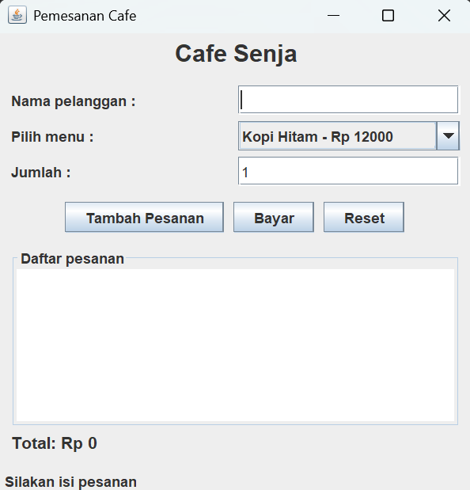
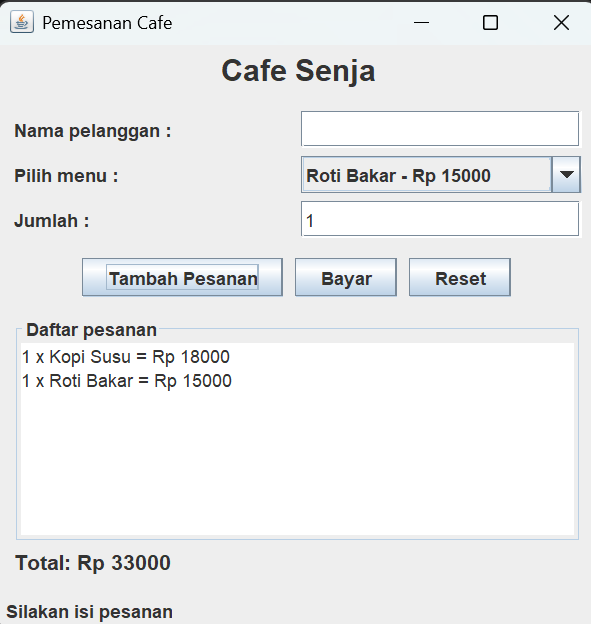
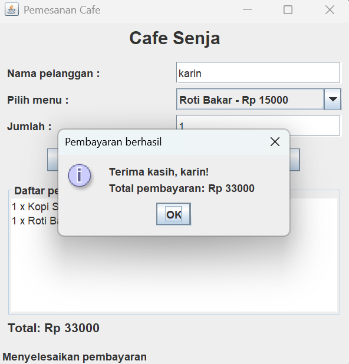
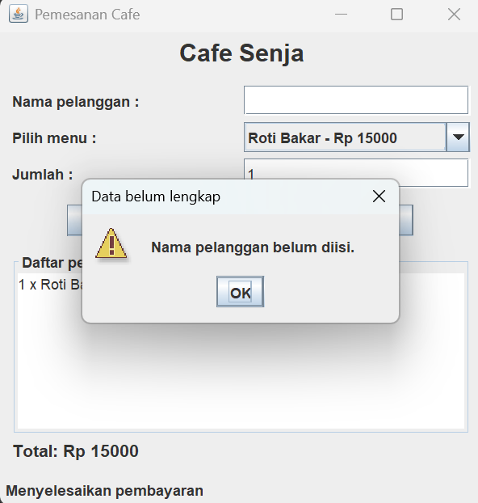

# Latihan GUI Java: Pemesanan Cafe

**Nama : ZUNNUN QORINA** 
**NIM  : F1D02410030** 

## Tentang program

Program ini adalah aplikasi pemesanan cafe yang sederhana, dibuat dengan Java Swing. Cara pakainya:

1. Isi nama pelanggan.
2. Pilih menu dari daftar, lalu isi jumlahnya.
3. Tekan **Tambah Pesanan**. Pesanan masuk ke daftar dan total harga ikut bertambah.
4. Tekan **Bayar** kalau sudah selesai. Akan muncul pesan terima kasih beserta total pembayaran.
5. Tombol **Reset** dipakai untuk menghapus semua isian dan pesanan.

## 5 komponen utama GUI yang dipakai

| No | Komponen | Class / Interface yang dipakai | Fungsi di program ini |
|----|----------|-------------------------------|----------------------|
| 1 | Top-level container | `JFrame` | Jendela utama aplikasi. Judulnya "Pemesanan Cafe". |
| 2 | Intermediate container | `JPanel`, `JScrollPane` | `JPanel` mengelompokkan komponen (judul, input, tombol, status). `JScrollPane` membungkus daftar pesanan agar bisa di-scroll. |
| 3 | Atomic component | `JLabel`, `JTextField`, `JComboBox`, `JButton`, `JTextArea` | `JLabel` untuk tulisan, `JTextField` untuk nama dan jumlah, `JComboBox` untuk memilih menu, `JButton` untuk tombol, `JTextArea` untuk daftar pesanan. |
| 4 | Layout | `BorderLayout`, `GridLayout`, `FlowLayout` | `BorderLayout` mengatur posisi atas, tengah, dan bawah. `GridLayout` mengatur kolom input dalam 3 baris x 2 kolom. `FlowLayout` menyusun judul dan tombol berurutan. |
| 5 | Event listener | `ActionListener` (interface), `MouseAdapter` (adapter class) | `ActionListener` menangani klik tombol. `MouseAdapter` mendeteksi mouse masuk dan keluar dari tombol. |

### Penjelasan singkat bagian event

**ActionListener.** Class `PemesananCafe` mengimplementasikan `ActionListener`, lalu menulis isi method `actionPerformed()`. Method ini dipanggil setiap ada tombol yang diklik. Di dalamnya, program mengecek tombol mana yang diklik dengan `e.getSource()`, lalu menjalankan prosesnya (tambah pesanan, bayar, atau reset).

**MouseAdapter.** Interface `MouseListener` punya 5 method. Kalau dipakai langsung, kelima method harus ditulis walaupun tidak semuanya diperlukan. Dengan `MouseAdapter`, cukup menulis method yang dibutuhkan. Di program ini hanya `mouseEntered()` dan `mouseExited()` yang di-override.

## Daftar menu

| Menu | Harga |
|------|-------|
| Kopi Hitam | Rp 12.000 |
| Kopi Susu | Rp 18.000 |
| Teh Manis | Rp 8.000 |
| Roti Bakar | Rp 15.000 |
| Kentang Goreng | Rp 14.000 |

## Screenshot

Tampilan awal:

Setelah menambah pesanan:

Pesan pembayaran:

